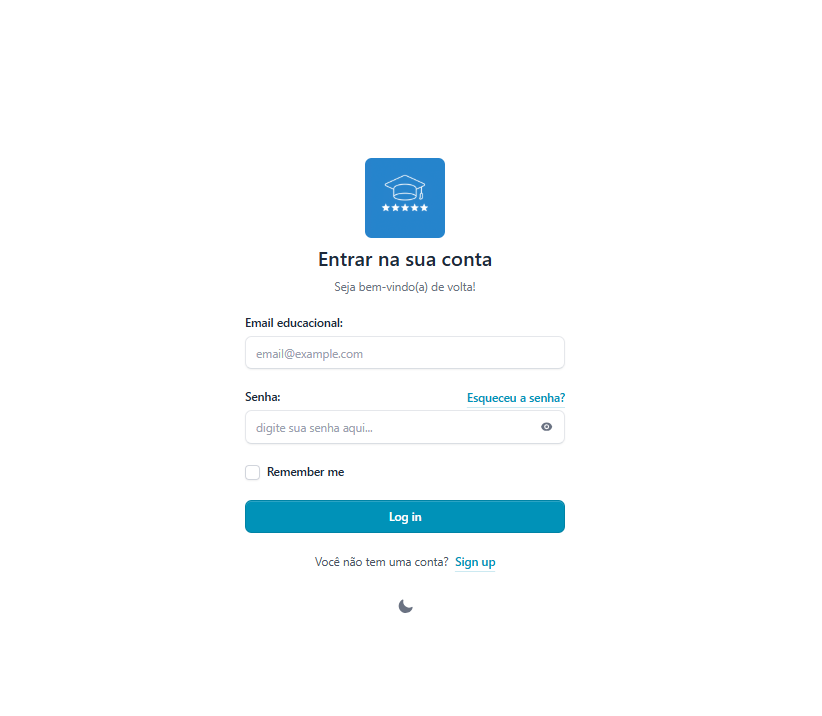
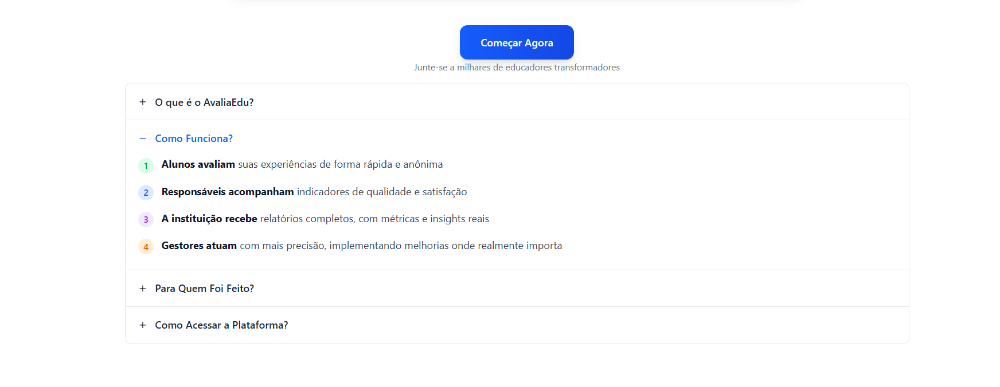
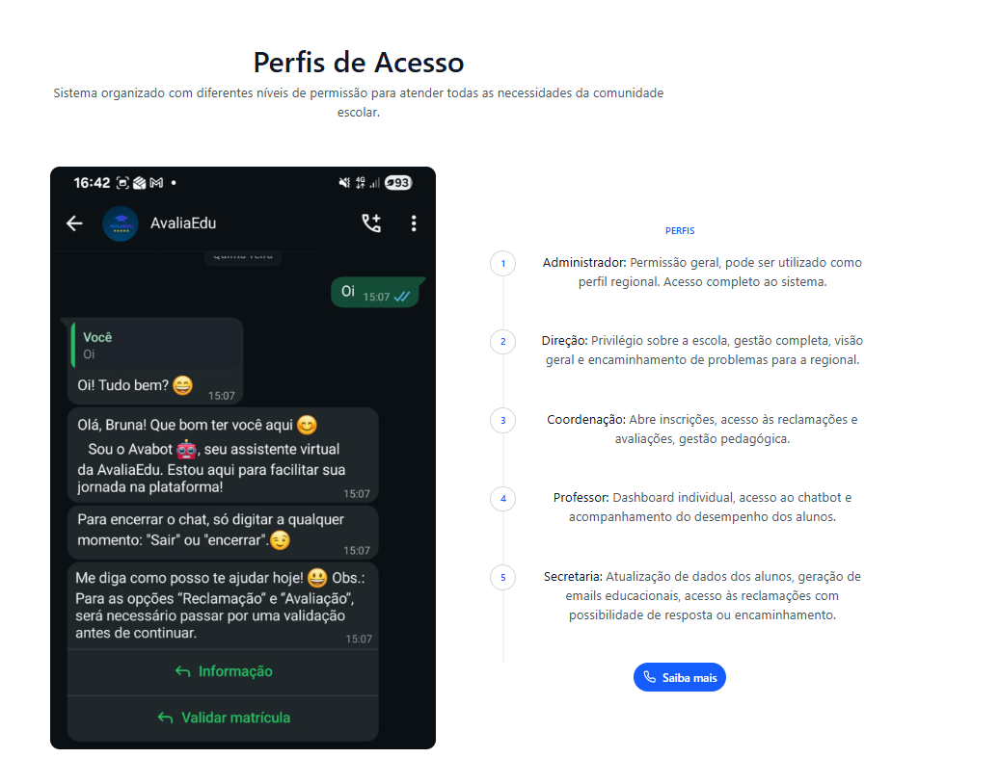
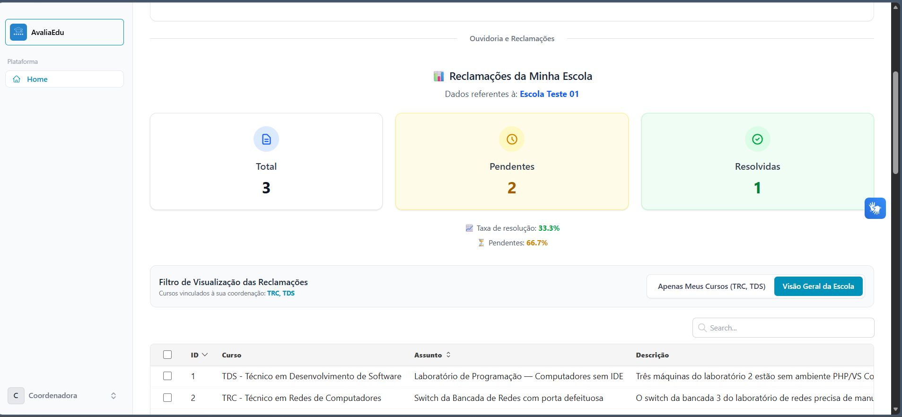

# 🎓 AvaliaEdu — Sistema de Avaliação Educacional e Ouvidoria Escolar

O **AvaliaEdu** é uma plataforma web institucional voltada à gestão de avaliações semestrais, ouvidoria escolar (manifestações, reclamações e elogios) e acompanhamento pedagógico em escolas técnicas e redes de ensino.




## 🚀 Tecnologias Utilizadas

- **Back-end:** PHP 8.2+ / Laravel 12
- **Autenticação e Segurança:** Laravel Fortify (com suporte a 2FA e ativação via Pré-Cadastro Institucional)
- **Front-end Reativo:** Livewire 3 + Volt + Flux UI + Alpine.js
- **Tabelas e Relatórios:** Livewire PowerGrid 6 + Maatwebsite Excel (Importação/Exportação CSV e XLSX)
- **Estilização e Gráficos:** Tailwind CSS 4 + Preline UI + Chart.js
- **Banco de Dados:** SQLite (padrão local rápido) ou MySQL / MariaDB

---

## 👥 Perfis de Acesso (Escopo MVP)

O sistema opera com controle de acesso baseado em perfis (*Role-Based Access Control*) e isolamento por unidade escolar (*Multi-Tenant por Escola*):

1. **Secretaria (`@secretaria.gov.br`):** Gestão de cursos, matrículas, alunos e pré-cadastro individual ou em lote (planilha) com geração automática de e-mail institucional.
2. **Direção (`@direcao.gov.br`):** Painel estratégico da unidade escolar, gestão de ouvidoria (reclamações/elogios) e abertura/fechamento de ciclos de avaliação.
3. **Coordenação (`@coordenacao.gov.br`):** Acompanhamento pedagógico por curso, indicadores de avaliação e manifestações vinculadas.
4. **Professor (`@professor.gov.br`):** Visualização de feedback pedagógico consolidado e indicadores das turmas.
5. **Aluno (`@aluno.gov.br`):** Participação nas avaliações semestrais anônimas (com validação de vínculo ativo) e registro de manifestações na ouvidoria.


---

## 🛠️ Pré-requisitos para Rodar Localmente

Certifique-se de ter instalado em sua máquina:

- **PHP 8.2 ou superior** (com as extensões `pdo_sqlite` / `sqlite3` ou `pdo_mysql`, `mbstring`, `xml`, `ctype`, `json`, `gd` e `zip` habilitadas no `php.ini`)
- **Composer 2.x**
- **Node.js 18+ e NPM**
- **Git**

---

## 📦 Passo a Passo de Instalação (Do Zero)

### 1. Clonar o repositório
```bash
git clone <URL_DO_SEU_REPOSITORIO>
cd tcc-ava
```

### 2. Instalar as dependências do PHP (Composer)
```bash
composer install
```
> **Nota (Windows):** Caso o seu PHP não esteja com a extensão `zip` ou `gd` habilitada no `php.ini`, ative-as ou execute `composer install --ignore-platform-reqs`.

### 3. Configurar o arquivo de ambiente (`.env`)
Copie o arquivo `.env.example` para `.env` e gere a chave da aplicação:

**No Windows (PowerShell):**
```powershell
Copy-Item .env.example .env
php artisan key:generate
```

**No Linux / macOS / Git Bash:**
```bash
cp .env.example .env
php artisan key:generate
```

### 4. Configurar o Banco de Dados (SQLite ou MySQL)

#### Opção A: Usando SQLite (Recomendado para teste rápido — não precisa de servidor MySQL)
1. No arquivo `.env`, ajuste o bloco de banco de dados para:
   ```env
   DB_CONNECTION=sqlite
   # DB_HOST=127.0.0.1
   # DB_PORT=3306
   # DB_DATABASE=avali_teste_db
   # DB_USERNAME=root
   # DB_PASSWORD=
   ```
2. Crie o arquivo vazio do banco SQLite:
   - **Windows (PowerShell):**
     ```powershell
     [System.IO.File]::WriteAllBytes("$PWD\database\database.sqlite", [byte[]]@())
     ```
   - **Linux / macOS / Git Bash:**
     ```bash
     touch database/database.sqlite
     ```

#### Opção B: Usando MySQL / MariaDB
1. Crie um banco de dados chamado `avali_teste_db` no seu MySQL.
2. Mantenha `DB_CONNECTION=mysql` no `.env` e informe seu `DB_USERNAME` e `DB_PASSWORD`.

### 5. Executar as Migrations e Popular o Banco (Seeders)
```bash
php artisan migrate:fresh --seed
```

### 6. Instalar dependências do Front-end e Compilar Assets (Vite)
```bash
npm install
npm run build
```

---

## ▶️ Como Executar o Projeto

Após o `npm run build`, basta iniciar o servidor do Laravel:

```bash
php artisan serve
```

Acesse no navegador: **http://localhost:8000**

*(Opcional) Se estiver alterando arquivos CSS/Blade em tempo real durante o desenvolvimento, abra um segundo terminal e execute:*
```bash
npm run dev
```

---

## 🔑 Credenciais Fictícias de Teste (Exclusivas para Ambiente Local)

> **⚠️ Aviso de Segurança:** Todas as credenciais, domínios e dados gerados pelo [`UserSeeder`](database/seeders/UserSeeder.php) são **estritamente fictícios e demonstrativos**, destinados apenas à execução local em ambiente de desenvolvimento/avaliação.

Após rodar `php artisan migrate:fresh --seed`, você pode testar o login em **http://localhost:8000/login** com os seguintes usuários de demonstração:

| Perfil | E-mail | Senha |
| :--- | :--- | :--- |
| **Secretaria** | `teste@secretaria.gov.br` | `Secretaria123#!` |
| **Direção** | `teste@direcao.gov.br` | `Direcao123#!` |
| **Coordenação** | `teste@coordenador.gov.br` | `Coordenacao123#!` |
| **Professor** | `teste@professor.gov.br` | `Professor123#!` |
| **Admin** | `admin@avaliaedu.com` | `Admin123#!` |

---

## 👥 Equipe do Projeto (Concepção TCC `v1.0` & Refatoração `v2.0`)

- **Beatriz:** Levantamento e documentação dos requisitos iniciais, desenvolvimento de telas front-end e modelagem do sistema.
- **Bruna:** Desenvolvimento back-end, integração Laravel com chatbot, *code reviews*, gestão de tarefas e **Auditoria Arquitetural / Refatoração Técnica (`v2.0` — 01/11/2026)**.
- **Laiane:** Design das telas no Figma (`v1.0`), definição do fluxo do chatbot via WhatsApp e execução de testes da aplicação.
- **Luiz:** Desenvolvimento front-end, modelagem do banco de dados e organização das atividades no Trello.

---

## 🧹 Solução de Problemas Comuns (Troubleshooting)

- **Erro `The bootstrap\cache directory must be present and writable` (comum em pastas sincronizadas pelo OneDrive no Windows):**
  Execute no PowerShell na raiz do projeto:
  ```powershell
  mkdir -Force bootstrap\cache, storage\framework\cache\data, storage\framework\sessions, storage\framework\views, storage\logs
  attrib -R bootstrap /S /D
  attrib -R storage /S /D
  php artisan optimize:clear
  ```
- **Limpar caches de rotas, views e configurações:**
  ```bash
  php artisan optimize:clear
  ```

---
## 📸 Telas do Sistema

## Tela Inicial





## Perfil - Coordenação


## 📄 Documentação de Requisitos e Evolução Técnica

O documento consolidado de requisitos e melhorias do MVP encontra-se na pasta `docs/`:
- [`Documento_de_Requisitos_AVALIAEDU_V02.pdf`](./docs/Documento_de_Requisitos_AVALIAEDU_V02.pdf)

> [!NOTE]
> ### 📌 Nota — Evolução Técnica e Ajustes (`v1.0` AS-IS → `v2.0` TO-BE)
>
> O projeto passou por ajustes em **16 pontos** para viabilizar o funcionamento ponta a ponta, mitigar gargalos de banco de dados e adequar o código aos padrões do Laravel 12 e Livewire 3:
>
> | Dimensão | Como Era (`AS-IS` — `v1.0`) | Como Ficou (`TO-BE` — `v2.0`) |
> | :--- | :--- | :--- |
> | **1. Primeiro Acesso (Fortify)** | Referência a Model/tabela inexistente (`PreRegistro`), variável não consultada no banco e regex bloqueando 3 perfis. | Unificação no Model `PreCadastro`, transação com `lockForUpdate()` e validação aceitando os 5 domínios institucionais. |
> | **2. Geração de Matrículas** | `save()` repetido dentro de loop `do...while` sem transação (sujeito a *Race Condition*). | Encapsulamento em `DB::transaction()` com bloqueio `lockForUpdate()` e escrita única ao final do cálculo. |
> | **3. Consultas no Banco (N+1)** | Consultas `Role::where()` dentro de loops de importação, 3 `COUNT(*)` separados e dados carregados em memória. | Pré-carregamento via `pluck()`, consolidação em query única com `SUM(CASE WHEN...)` e agregação via `GROUP BY`. |
> | **4. Isolamento por Escola** | `escola_id = 1` fixo na importação e tabelas PowerGrid listando registros de todas as escolas misturados. | Vínculo dinâmico com `Auth::user()->escola_id` e filtro `scopeDaEscola()` nas listagens e exclusões. |
> | **5. Padrão PSR-4 e Livewire 3** | Colisão de classe PSR-4, namespaces do Livewire 2, `emitSelf` antigo e `sleep(3)` travando a requisição. | Alinhamento ao autoloader PSR-4, eventos `#[On]` / `$this->dispatch()` do Livewire 3 e remoção do `sleep(3)`. |
> | **6. Portabilidade (`SQLite`/`MySQL`)** | Comando `SET FOREIGN_KEY_CHECKS=0` exclusivo do MySQL impedindo os seeders de rodarem em SQLite. | Uso de `Schema::disableForeignKeyConstraints()` compatível tanto com SQLite quanto com MySQL. |
>
> 📄 **Detalhamento completo dos 16 ajustes e requisitos:** [`Documento_de_Requisitos_AVALIAEDU_V02.pdf`](./docs/Documento_de_Requisitos_AVALIAEDU_V02.pdf)


